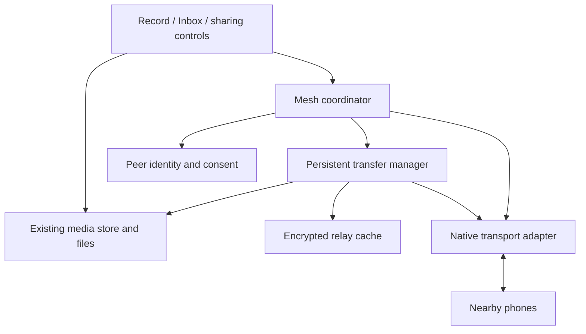

# PiperNet mesh architecture

Status: proposal for the next implementation phase. Only the current foundation below exists today; transport, peer identity, delivery tracking, and relaying still need to be built.

## Current foundation

The app uses Expo SDK 57, React Native, and Expo Router. Screens live directly in `src/app/`; shared components, hooks, and stores live outside the route directory.

| Area                        | Existing responsibility                                     |
| --------------------------- | ----------------------------------------------------------- |
| `src/app/onboarding/`       | First-launch introduction and camera/microphone permissions |
| `src/app/(tabs)/index.tsx`  | Capture, preview, retake, and queue photos/videos           |
| `src/app/(tabs)/inbox.tsx`  | Received/Queued views, playback, read state, and deletion   |
| `src/stores/media-store.ts` | Serialized media transactions and persistent metadata       |
| `src/lib/media-files.ts`    | Compression, thumbnails, durable files, and cleanup         |
| `src/lib/media-policy.ts`   | Capture and payload limits                                  |

`queue(draft)` saves an outgoing capture locally. `receive(id, sender, draft)` saves a complete incoming file and suppresses identifiers already in the library. Neither method discovers peers or sends data. Metadata uses AsyncStorage; media files live in the app's document directory.

Current limits are 100 KiB per photo, 5 MiB per video, and a 60-second recording limit. Photos target a longest edge of 640 px. These limits should also constrain received plaintext media; claimed metadata alone is insufficient validation.

## Proposed scope

Build direct offline sharing between two phones first, then add bounded store-and-forward relaying: phone A can hand encrypted media to B, which later forwards it to C. Phones need not all be connected at once. Delivery remains best effort and requires compatible, participating devices to meet before expiry.

For the first version, assume users select a recipient and accept incoming sharing. A capture can remain queued without a recipient. Relaying requires a separate opt-in and must never put transit media in a relay's Received view. Group broadcast and sharing with unknown recipients remain product decisions rather than protocol assumptions.

The initial runtime is foreground-only, with no account, server, or internet dependency for delivery. Pause discovery and transfers when the app becomes inactive; persist work and resume on return. iOS background Bluetooth behavior is restricted, so continuous background mesh operation needs a separate device study. See [Apple's background processing guidance](https://developer.apple.com/library/archive/documentation/NetworkingInternetWeb/Conceptual/CoreBluetooth_concepts/CoreBluetoothBackgroundProcessingForIOSApps/PerformingTasksWhileYourAppIsInTheBackground.html).

## Component boundaries

- **Mesh coordinator:** owns discovery sessions, connection policy, scheduling, and lifecycle. Screens request actions and observe state through hooks; they do not manage radios.
- **Peer registry:** maps verified public-key identities to local labels, trust decisions, and blocked peers. Temporary discovery IDs are connection handles, not trusted identities.
- **Transfer manager:** owns offers, validation, disk-backed transfers, retries, receipts, and recovery after restart.
- **Relay cache:** stores opaque encrypted payloads with expiry and quotas, separately from the media library.
- **Transport adapter:** exposes capabilities, discovery, connect/disconnect, control messages, file transfers, cancellation, and progress events. Native code handles radio work and file I/O; JavaScript receives metadata and throttled progress, not whole videos or base64 payloads.

Proposed placement is `src/lib/mesh/` for coordination and protocol logic, `src/types/mesh.ts` for contracts, `src/stores/mesh-store.ts` for observable state, and `src/hooks/use-mesh.ts` for UI access. Add `modules/nearby-transport/` only if a local native module is needed. These paths are a plan, not existing files.

## Transport decision

Evaluate Google Nearby Connections first. Its native APIs provide offline discovery and encrypted peer connections using Bluetooth/BLE/Wi-Fi, with file transfer support. This is a candidate, not a selected dependency. See the [API overview](https://developers.google.com/nearby/connections/overview), [Android setup](https://developers.google.com/nearby/connections/android/get-started), and [Swift setup](https://developers.google.com/nearby/connections/swift/get-started).

Before selection, prove iOS-to-Android interoperability in both directions, same-platform sharing, permissions, native dependency integration, and performance for a maximum-size video. Evaluate the Android Google Play services requirement and SDK diagnostics behavior against product needs.

Nearby's point-to-point and cluster strategies have different topology/throughput tradeoffs. A cluster connection topology does not itself provide application-level multi-hop delivery; PiperNet must implement relay storage, forwarding, and receipts. Choose the strategy from device measurements. See [Nearby connection strategies](https://developers.google.com/nearby/connections/strategies).

If this candidate fails, evaluate a shared BLE protocol behind the same adapter. Do not assume a BLE-only path can transfer 5 MiB videos acceptably; measure it before committing. Platform-specific transports must implement a compatible wire protocol to communicate across platforms.

The transport needs a development build because it introduces native code. Use SDK-compatible installs with `bunx expo install <package>`, configure permissions/entitlements through app config and config plugins, and keep native implementation in a module rather than hand-editing generated `ios/` or `android/` directories. The existing `eas.json` has no development profile; add one during the transport spike. See [Expo custom native code](https://docs.expo.dev/workflow/customizing/) and [development builds](https://docs.expo.dev/develop/development-builds/introduction/).

## Identity, consent, and encryption

Generate a device key pair using a vetted native cryptographic implementation and keep private keys in platform-protected storage. A public-key fingerprint identifies a peer. Do not use a display name, radio address, or the existing local capture ID as proof of identity.

First contact requires both users to verify a pairing code or fingerprint bound to the authenticated connection and exchanged identity keys. Persist trust only after verification. A connection approval does not automatically grant permission to receive media or relay it. Blocking a peer stops new sessions and pending work involving that peer.

Encrypt each payload for its intended recipient before giving it to any relay. Authenticate the immutable envelope, including recipient, expiry, size, and ciphertext digest, with the sender's identity. Use a reviewed protocol/library for key agreement, authenticated encryption, signatures, and nonce handling; select the suite during the prototype and freeze it with the wire version. Transport encryption protects each connection, but recipient encryption must survive multiple hops.

The sender must already possess the recipient's verified public key for offline relay delivery. Relays can see routing metadata and ciphertext size but cannot view media, thumbnails, or private captions. Keep those inside the encrypted payload. Deleting the app or losing keys requires pairing again.

## Delivery protocol and persistence

Use a versioned envelope with a cryptographically random `messageId` independent of `MediaItem.id`. Persist a mapping between the outgoing capture, recipient, and message. A retry reuses the same message and ciphertext; creating a fresh ID on every attempt would defeat deduplication.

| Protocol information                                  | Purpose                                                     |
| ----------------------------------------------------- | ----------------------------------------------------------- |
| Version and capabilities                              | Reject unsupported peers before transfer                    |
| Message ID, sender and recipient key fingerprints     | Identify one authenticated delivery                         |
| Ciphertext length/digest and encrypted media metadata | Bound storage and validate the completed payload            |
| Creation/expiry time and relay allowance              | Limit retention and forwarding                              |
| Offer / accept / reject / cancel                      | Obtain consent and storage admission before receiving bytes |
| Transfer progress and completion                      | Track bytes independently of delivery                       |
| Recipient-signed receipt                              | Prove durable receipt by the intended recipient             |

The wire encoding and crypto suite must be identical on both platforms. Cap control-message sizes before parsing, allowlist fields and media types, and reject unsupported versions. Transfer native files or bounded chunks to temporary disk storage with backpressure; never allocate buffers from an untrusted declared length. Bound ciphertext overhead separately from plaintext media limits. Native transfer completion is not an application delivery receipt.

Receiving follows this order:

1. Verify the offer's identity, signature, recipient, expiry, consent, and quota; reserve bounded disk space before accepting.
2. Receive into an app-owned temporary file. Ignore remote filenames/paths. Retry interrupted files from the start initially; resumable chunks can follow once both adapters support them safely.
3. Check actual length/digest, decrypt/authenticate, and validate the actual media type, size, and duration before generating a local thumbnail.
4. Call `mediaStore.receive(localId, verifiedSenderLabel, draft)` only for the final recipient. Await durable saving before recording completion and sending a signed receipt.
5. Delete temporary files on completion, rejection, cancellation, or expiry. Recover stale partial files after restart.

Keep durable delivery records and deduplication tombstones outside the media library. The current `receive` check only finds items still present; deleting an Inbox item must not let a retransmission recreate it. Reconcile the transfer journal and library after a crash between saving media and recording the receipt. Re-send an existing receipt for a duplicate instead of creating another item.

Persist transfer metadata and relay indexes in a transactional journal, with media on disk. The exact storage implementation is still open. Treat file writes and journal updates as separate failure points and reconcile orphaned files on startup. Key operations should be idempotent.

UI delivery state is per recipient: waiting, connecting, sending, awaiting receipt, delivered, or failed/expired/cancelled. A relay's acceptance leaves the sender awaiting a recipient receipt. Local capture storage remains usable when discovery is unavailable or permissions are denied.

## Bounded mesh forwarding

Start with direct delivery preferred and a small number of trusted, consenting relay peers. Exchange bounded inventories of message IDs, request only missing messages, and keep a per-message forwarding ledger. Avoid sending a message back to the peer that supplied it. Do not build a global routing table for the first version.

Proposed initial limits, to tune with device measurements:

| Resource         | Initial policy                                            |
| ---------------- | --------------------------------------------------------- |
| Message lifetime | 24 hours, with a local retention cap for clock skew       |
| Forwarding depth | At most 3 hops among cooperative peers                    |
| Relay fan-out    | At most 2 distinct next peers per stored message          |
| Relay storage    | 50 MiB total, plus an admission check for free disk space |
| Active work      | At most 2 peer connections and 1 bulk file transfer       |

Each holder persists forwarding attempts, expiry, and receipts across restarts. Local fan-out/depth bounds reduce propagation; they do not guarantee a global copy count or constrain a malicious peer. Enforce local byte, message-count, rate, and retry limits regardless of remote hop claims.

Use capped retries with backoff and jitter; pause when no suitable peer exists. Give user-requested direct transfers priority over relays. Purge expired/acknowledged transit payloads and relay work when the user disables relaying. Retain compact duplicate/receipt records through the accepted message lifetime plus a bounded clock-skew allowance. Receipts can travel back through relays and obey the same resource limits. Missing receipts leave delivery uncertain.

Deleting a queued capture cancels associated local transfers and relay offers. Already-forwarded copies cannot be reliably recalled from disconnected devices; they expire under their original envelope. Cancellation must not claim remote deletion.

## Implementation order and exit checks

| Phase              | Build                                                                                                            | Exit check                                                                                                                              |
| ------------------ | ---------------------------------------------------------------------------------------------------------------- | --------------------------------------------------------------------------------------------------------------------------------------- |
| 1. Transport spike | Native adapter, config plugin, development builds, discovery and a test file                                     | Physical iOS/iOS, Android/Android, and iOS/Android pairs work without internet; measure latency, throughput, and battery use            |
| 2. Direct sharing  | Pairing, recipient selection/consent, encrypted envelopes, durable transfer records, Inbox integration, receipts | A real capture arrives once and survives restart; rejection, corruption, disconnect, storage failure, and duplicate retries are handled |
| 3. Relay mesh      | Opt-in relay cache, inventory exchange, bounded forwarding, returning receipts                                   | A -> B -> C works while A and C never meet; B cannot view media; loops, expiry, quota exhaustion, and lost receipts are handled         |
| 4. Hardening       | Recovery, permission changes, resource tuning, accessibility, diagnostics                                        | Background/foreground transitions and device restarts preserve honest state; sustained use stays within memory/storage/battery budgets  |

Protocol tests should cover malformed/oversized offers, altered envelopes, replay after Inbox deletion, clock skew, and restart during commit. Device testing must include maximum-size media, radio/permission changes, and peer loss in both directions. Logs should contain timing/error codes without private keys or media content. Run `bunx expo lint` and `bunx tsc --noEmit` for every implementation phase, plus the relevant unit tests.

The next concrete task is phase 1: establish cross-platform transport feasibility before integrating real media or adding relay behavior. Update this document when that experiment resolves the transport, crypto, and storage choices; routine UI changes do not need new documentation files.
